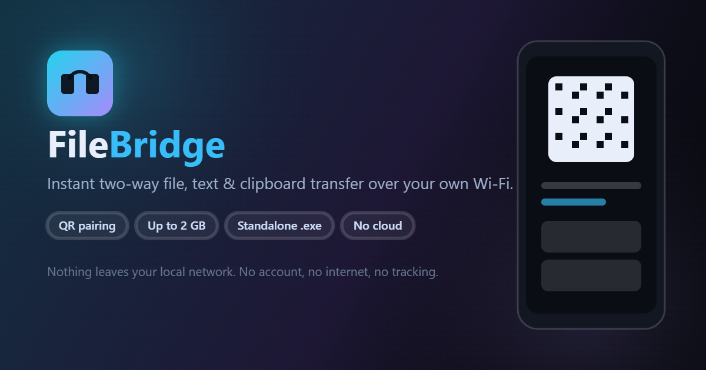
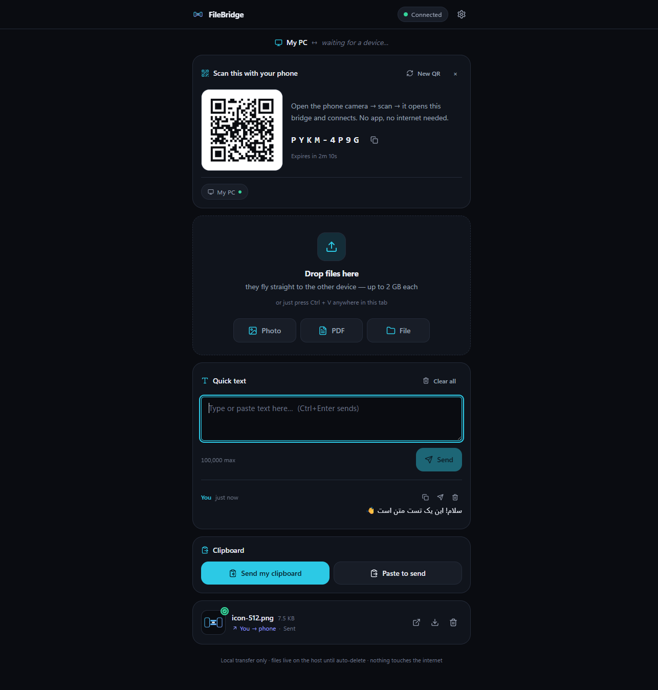

<p align="center">
  
</p>

<p align="center">
  <a href="https://github.com/Ekkh1300/FileBridge/releases/latest"></a>
  
  
  
</p>

# FileBridge

**Move files, text and clipboard between your phone and PC — over your own Wi‑Fi, in seconds.**
No account, no cloud, no internet, no tracking. A scan of one QR code connects both devices.

> 🇮🇷 [راهنمای کامل فارسی](#filebridge--انتقال-سریع-فایل-متن-و-کلیپ‌بورد-بین-موبایل-و-کامپیوتر) — setup, security notes, limitations and the Persian quick start live further down this page.



---

## ✨ Features

| | |
|---|---|
| 📱 **QR pairing** | The PC shows a QR, the phone scans it, done. No typing IPs, no ports. |
| 🔁 **Two-way, real time** | Files, photos, PDFs, text and clipboard flow in both directions over WebSocket. |
| 📦 **Up to 2 GB per file** | Chunked 4 MB uploads with **resume** — if the Wi‑Fi drops, it continues where it stopped. |
| 🖼️ **Original quality previews** | Photos, videos and PDFs preview inline; everything else is served as a safe download. |
| 📋 **Clipboard & text** | One-tap clipboard send/paste with a small history. |
| 📊 **Live progress** | Per-file progress bars for uploads *and* downloads (percent + MB transferred). |
| 🕒 **Auto-delete** | Received files are removed after 1 h / 24 h / 7 d / never — they never leave the host PC. |
| 🔒 **Hardened** | HttpOnly device tokens (SHA‑256 at rest), isolated sessions, strict CSP sandboxing, rate limits, magic-byte file typing. |
| 🖥️ **Standalone `.exe`** | One 57 MB file with the Node runtime inside — no install, no Node.js, no internet needed. |
| 🌗 **Dark & light, mobile-first** | Designed phone-first, works on any modern browser. |

## ⬇️ Download

**Windows (recommended):** grab the installer from the [latest release](https://github.com/Ekkh1300/FileBridge/releases/latest).

| Asset | What it is |
|---|---|
| `FileBridge-Setup-v0.1.0.exe` | **Real installer** — Start-menu entry, optional desktop shortcut, Add/Remove Programs entry, clean uninstall (it even asks whether to delete your received files). Installs per user, no admin rights needed. |
| `FileBridge-Portable.zip` | The same app as a single portable file — unzip and run, nothing is installed. |

Installing:

1. Run `FileBridge-Setup-v0.1.0.exe` (Windows SmartScreen may say *“unknown publisher”* → **More info → Run anyway**).
2. The browser opens automatically; press **Start on this computer**.
3. Allow the Windows firewall prompt on **Private networks** (one time).
4. Scan the QR with your phone camera. Files land in `FileBridge Data` next to the exe (or in `%LOCALAPPDATA%\FileBridge` when installed in a read-only folder).

> macOS / Linux: run it from source (below) — the server is plain Node.js.

## 📱 Install as an app (PWA) + reach it from anywhere

Over plain `http://` a browser refuses to install a web app. Serve FileBridge over **HTTPS** and it becomes a real app — installable, offline-capable, and it unlocks clipboard read, notifications and Web Crypto.

The easiest way is **Tailscale Serve** (private network, real certificate, no router setup, no port forwarding):

```bash
npm run tailscale      # prints the exact commands for your machine
```

```powershell
# 1) expose the local server over https (only devices in your tailnet can reach it)
tailscale serve --bg http://127.0.0.1:3000

# 2) start FileBridge so the pairing QR points at that https address
$env:PUBLIC_URL = "https://your-pc.your-tailnet.ts.net"
.\FileBridge.exe
```

On the phone: install Tailscale, join the same tailnet, open the https address → Chrome offers **“Add to Home screen”**. The app then launches full-screen, keeps working offline (cached shell) and can read the clipboard.

Without Tailscale, any reverse proxy with a certificate works the same way — set `PUBLIC_URL` to its address.

## 🚀 Run from source

```bash
git clone https://github.com/Ekkh1300/FileBridge.git
cd FileBridge
npm install        # server + client workspaces
npm run build      # build the web client
npm start          # serve on http://localhost:3000
```

Development mode with hot reload: `npm run dev` (API on `:3000`, Vite on `:5173`).
Build the standalone executable yourself: `npm run exe` → `release/FileBridge.exe`.

## 🏗️ How it works

```
phone  ──HTTP/WS──▶  Fastify 5  ──▶  node:sqlite (sessions, devices, transfers)
                        │
                        ├── @fastify/websocket  → live events (transfer progress, text, clipboard)
                        ├── chunked upload API → 4 MB chunks, resumable, sender-only writes
                        └── @fastify/static    → the React 18 + Vite client, served by the same server
```

* **One process, one port.** The same Node server serves the API, the WebSocket hub and the web UI — nothing else to install or configure.
* **No native dependencies.** Storage is Node's built-in `node:sqlite`; everything else is pure JavaScript.

## 🔒 Security model

* Session cookie `fb_tok` is **HttpOnly** — unreadable from JavaScript; only its SHA‑256 hash is stored.
* Sessions are **isolated**: a device of one session gets `404` for another session's files and messages.
* Uploaded files are **never executed**: their real type is detected by magic bytes, only inert types
  (image / PDF / video / audio / plain text) are served inline, and everything is served with
  `Content-Security-Policy: default-src 'none'; sandbox allow-downloads` + `X-Content-Type-Options: nosniff`.
* Filenames are sanitised, on-disk paths are UUIDs, pairing codes expire after 10 minutes and are single-use.
* Rate limiting on the API, a 2 GB file cap and a 100 000 character text cap.

## 🧪 Tests

```bash
node server/test/smoke.mjs     # 36 assertions: pairing, WS realtime, chunked upload,
                               # byte-identical download, sniffing, session isolation,
                               # path traversal, resume, revocation, session wipe
```

## 📄 License

[MIT](LICENSE) © 2026 Ekkh1300 — use it, fork it, ship it.

---
# FileBridge — انتقال سریع فایل، متن و کلیپ‌بورد بین موبایل و کامپیوتر

> **FileBridge** — a local-only (LAN) web app for instant two-way transfer of files, text and clipboard between your phone and PC. Scan a QR, get connected. Ships as a standalone `FileBridge.exe` for Windows (Node.js included, portable). [راهنمای فارسی در همین صفحه 👇](#استفاده) · [Download exe](../../releases) · v0.1.0

FileBridge یک وب‌اپ **محلی (LAN)** است: کامپیوتر یک QR نشان می‌دهد، گوشی اسکن می‌کند و بلافاصله به همان صفحه وصل می‌شود. بعد از آن هر چیزی — عکس، PDF، هر نوع فایل (تا ۲ گیگابایت)، متن یا کلیپ‌بورد — در هر دو جهت، بی‌درنگ و روی وای‌فای خودتان رد و بدل می‌شود. **هیچ داده‌ای از شبکه محلی بیرون نمی‌رود.**

---

## شروع سریع

پیش‌نیاز: **Node.js نسخه ۲۲ یا بالاتر** (تست‌شده روی Node 26). ویندوز/مک/لینوکس فرقی ندارد.

```powershell
# ۱) نصب وابستگی‌های سرور و کلاینت با هم
npm install

# ۲) ساخت نسخه نهایی کلاینت
npm run build

# ۳) اجرای سرور
npm start
```

بعد از چند ثانیه سرور می‌گوید:

```
  On this PC:  http://localhost:3000
  On your phone (same Wi-Fi):  http://192.168.x.x:3000
```

سپس:

1. در کامپیوتر `http://localhost:3000` را باز کنید و **Start on this computer** را بزنید.
2. با دوربین گوشی **QR** را اسکن کنید (یا کد ۸‑حرفی زیر QR را دستی وارد کنید).
3. تمام! حالا می‌توانید درگ‌اند‌دراپ کنید، عکس/PDF بفرستید و متن و کلیپ‌بورد رد و بدل کنید.

> اگر گوشی وصل نشد: دو دستگاه باید **روی یک وای‌فای** باشند و احتمالا فایروال اجازه نداده است — بخش «فایروال ویندوز» را ببینید.

### حالت توسعه (سرور API + Vite با Hot Reload)

```powershell
npm run dev
```

سرور روی `:3000` و کلاینت Vite روی `:5173` بالا می‌آید؛ آدرس موبایل همان `http://192.168.x.x:5173` است.

---

## استفاده

- **ارسال فایل**: کشیدن و رها کردن در صفحه (PC)، دکمه‌های Photo/PDF/File (هر دو دستگاه)، یا `Ctrl+V` پیست فایل در تب.
- **پیش‌نمایش**: عکس/ویدیو بلافاصله بندانگشتی می‌گیرند؛ روی دریافت‌شده‌ها دکمه Open (پیش‌نمایش در تب جدید) و Download هست. کیفیت اصلی دست‌نخورده منتقل می‌شود.
- **متن و کلیپ‌بورد**: کارت Quick text (با تاریخچه و دکمه‌های Copy/Reuse/Delete) و کارت Clipboard.
- **صف انتقال**: پیشرفت زنده، Cancel هنگام ارسال، Retry برای ناموفق. فایل‌های بزرگ به قطعات ۴ مگابایتی شکسته می‌شوند؛ اگر وسط کار شبکه قطع شد، از همان جا **از سر گرفته** می‌شود.
- **وضعیت اتصال**: چراغ هدر (🟢 Connected / 🟡 Reconnecting / 🔴 Offline). قطع و وصل سرور/وای‌فای خودکار دوباره وصل می‌شود و لیست‌ها همگام می‌مانند.

### تنظیمات (چرخ‌دنده هدر)

- **نام دستگاه** — نامی که به طرف مقابل نشان داده می‌شود.
- **Auto-delete received files** — `۱ ساعت / ۱ روز / ۷ روز / هرگز`.
- **تم Dark / Light**.
- **Devices** — لیست دستگاه‌های جلسه؛ حذف (Revoke) توسط میزبان، Leave برای مهمان.
- **End session for everyone** — فقط میزبان: جلسه برای همه بسته و **همه فایل‌ها همان لحظه از دیسک پاک می‌شوند**.
- **Close FileBridge** — فقط میزبان: اپ کامل می‌بندد (فایل‌ها پاک می‌شوند و پنجرهٔ سیاه خودش بسته می‌شود).

---

## امنیت — چه چیزهایی ساخته شده است

- **توکن دستگاه** در کوکی `HttpOnly` (`fb_tok`) است؛ توسط JS صفحه خوانده نمی‌شود و در دیتابیس فقط هش SHA‑256 آن ذخیره می‌شود.
- **جلسات ایزوله‌اند**: هیچ دستگاهی به فایل/پیام جلسه دیگر دسترسی ندارد (تست شده — پاسخ ۴۰۴).
- **فایل‌ها هرگز اجرا نمی‌شوند**: نوع واقعی فایل با magic-bytes تشخیص داده می‌شود؛ فقط انواع بی‌خطر (تصویر، PDF، ویدیو، صدا، متن ساده) inline نمایش داده می‌شوند و بقیه فقط برای دانلودند. همه فایل‌ها با CSP سخت‌گیرانه (`default-src 'none'` + sandbox) و هدر `nosniff` سرو می‌شوند.
- **نام فایل‌ها پاک‌سازی می‌شوند** (`../` و کاراکترهای خطرناک)؛ مسیر ذخیره روی دیسک UUID است و نام فایل هرگز وارد مسیر نمی‌شود.
- **Rate limit** روی همه APIها + سقف حجم فایل (۲GB) + سقف طول متن (۱۰۰ هزار کاراکتر) + سقف دستگاه (۸ تا).
- **کدهای جفت‌شدن (pairing)** ۸‑حرفی با عمر ۱۰ دقیقه و تک‌مصرف.
- **هیچ توکن یا secret ای در لاگ‌ها نمی‌نویسد.**

## محدودیت‌های صادقانه (به‌خاطر محدودیت مرورگرها، نه کاهلی)

| قابلیت | وضعیت روی `http://LAN` | راه‌حل |
| --- | --- | --- |
| خواندن کلیپ‌بورد سیستم (`navigator.clipboard.readText`) | معمولا مسدود است (خصوصا موبایل) | دکمه «Paste to send» — کاربر دستی پیست می‌کند |
| نوشتن در کلیپ‌بورد (`writeText`) | با کلیک کاربر معمولا کار می‌کند (با fallback) | — |
| نصب به‌عنوان PWA | فقط با HTTPS ممکن است | HTTPS خودمیزبان (بخش بعدی) |
| اعلان دسکتاپ | فقط HTTPS/localhost | toast خودِ UI |
| بندانگشتی HEIC/HEIF | ندارد | فایل منتقل می‌شود ولی پیش‌نمایش ندارد |
| Download روی بعضی کروم‌ها | کروم ممکن است برای دانلود از صفحهٔ http بنر «This file may be dangerous» بدهد | روی همین اعلان فلش/سه‌نقطه را بزن و **Keep / Download anyway** را انتخاب کن — فایل سالم است؛ سرتیفیکه‌ی هشدار از خود کروم است نه از FileBridge |

**چرا؟** مرورگرها این قابلیت‌ها را در «Secure Context» (HTTPS یا localhost) قفل کرده‌اند و `http://192.168.x.x` امن محسوب نمی‌شود. همه وب‌اپ‌های مشابه LAN همین محدودیت و همین جایگزین‌ها را دارند.

## اتصال امن (اختیاری)

برای فعال شدن PWA، اعلان و کلیپ‌بوردِ کامل: یک گواهی محلی بسازید (مثلا با `mkcert`) و سرور را پشت TLS بگذارید. برای **دسترسی از اینترنت**(خارج از LAN) ساده‌ترین راه معتبر Tailscale/WireGuard بین دو دستگاه است — بدون تغییر کد.

## فایروال ویندوز (بار اول)

اگر گوشی وصل نمی‌شود:

```powershell
# PowerShell (Run as Administrator):
New-NetFirewallRule -DisplayName "FileBridge" -Direction Inbound -Action Allow `
  -Program (Get-Command node).Source -Profile Private
```

یا در پنجره اجازه‌ای که هنگام اولین اجرا می‌آید، تیک **Private networks** را بزنید.

## نسخهٔ نصبی — FileBridge.exe (بدون نیاز به Node.js)

می‌توانید کل برنامه را در **یک فایل exe مستقل** بسازید که Node.js، سرور و رابط کاربری همه داخلش هستند:

```powershell
# یک‌بار: ساخت آیکون + باندل + بسته‌بندی  (خروجی: release/FileBridge.exe + FileBridge-Portable.zip)
npm run exe

# ساخت installer واقعی (Inno Setup 6/7 — خروجی: release/FileBridge-Setup-v0.1.0.exe)
npm run installer
```

**Installer واقعی** چه می‌کند:
- نصب per-user (بدون نیاز به Administrator) در `%LOCALAPPDATA%\Programs\FileBridge`
- آیکون در **منوی استارت** + **شورتکات دسکتاپ** (اختیاری) + ورودی در «Add/Remove Programs»
- اجرای خودکار برنامه بعد از نصب + راه‌اندازی با **Start on this computer**
- **حذب تمیز**: unins000.exe همه‌چیز را پاک می‌کند و حتی می‌پرسد «فایل‌های دریافتی و دیتابیس هم پاک شوند؟»

- اجرا: روی `FileBridge.exe` دوبار کلیک کنید — مرورگر خودش باز می‌شود (SmartScreen بار اول: More info → Run anyway).
- داده‌ها کنار exe در پوشهٔ `FileBridge Data` ذخیره می‌شوند؛ اگر exe در جای فقط‌خواندنی نصب شود (Program Files) مسیر `%LOCALAPPDATA%\FileBridge` استفاده می‌شود.
- پورت پیش‌فرض 3000؛ تغییر: `set PORT=3100 && FileBridge.exe`
- فایروال بار اول: تیک **Private networks** → Allow (همان‌طور که بالا گفتیم؛ برای exe اسم برنامه FileBridge.exe است).
- اندازهٔ exe حدود 57MB (زمان اجرای node22 داخلی است) و installer حدود 16MB. برای ساخت نسخه لینوکس/مک همین اسکریپت با تارگت متناسب قابل استفاده است.
- بازسازی خودکار: `node tools/build-exe.mjs` باندل esbuild + pkg را اجرا می‌کند.

## نصب به‌عنوان اپ روی گوشی (PWA) + دسترسی از بیرون شبکه

روی `http://` مرورگرها اجازهٔ نصب اپ وب نمی‌دهند. اگر FileBridge را روی **HTTPS** سرو کنید، تبدیل به یک اپ واقعی می‌شود: قابل نصب، قابل اجرای آفلاین، و کلیپ‌بورد/اعلان‌ها/Web Crypto هم فعال می‌شوند.

ساده‌ترین راه: **Tailscale Serve** (شبکهٔ خصوصی، گواهی واقعی، بدون تنظیم مودم و بدون پورت‌فورد):

```powershell
npm run tailscale     # دستورهای دقیق مخصوص سیستم خودتان را چاپ می‌کند

# ۱) سرو کردن روی https (فقط دستگاه‌های داخل tailnet شما دسترسی دارند)
tailscale serve --bg http://127.0.0.1:3000

# ۲) اجرای FileBridge طوری که QR به همان آدرس https اشاره کند
$env:PUBLIC_URL = "https://your-pc.your-tailnet.ts.net"
.\FileBridge.exe
```

روی گوشی: Tailscale را نصب و با همان حساب وارد کنید، آدرس https را باز کنید → کروم گزینهٔ **Add to Home screen** را می‌دهد. اپ تمام‌صفحه اجرا می‌شود، آفلاین (پوستهٔ کش‌شده) هم کار می‌کند و کلیپ‌بورد خواندنی می‌شود.

بدون Tailscale هم هر reverse proxy دارای گواهی کار می‌کند — کافی است `PUBLIC_URL` را روی آدرسش بگذارید.

## تست

```powershell
# سرور در حال اجرا باشد، سپس:
node server/test/smoke.mjs
```

سناریوها: host/join، WS realtime، آپلود chunked، دانلود هم‌ارز بایت‌به‌بایت، sniff نوع فایل، ایزولگی جلسات، path traversal، محدودیت ارسال chunk به مالکش، حذف دستگاه (revoke)، resume آپلود، پایان جلسه و پاک‌سازی دیسک. خروجی سالم: **36 passed, 0 failed**.

## ساختار پروژه

```
share op/
├─ package.json          # npm workspaces (server + client)
├─ installer/
│  └─ filebridge.iss     # Inno Setup: نصب واقعی، منوی استارت، شورتکات، uninstall تمیز
├─ tools/
│  ├─ build-exe.mjs      # esbuild + pkg → release/FileBridge.exe
│  ├─ make-ico.mjs       # آیکون چندسایز .ico
│  ├─ gen-icons.mjs      # PNG آیکون‌های PWA
│  └─ tailscale-info.mjs # راهنمای HTTPS با Tailscale Serve
├─ client/public/
│  ├─ sw.js              # service worker (PWA: نصب + آفلاین، بدون کش کردن داده‌ها)
│  └─ manifest.webmanifest
├─ server/
│  ├─ src/
│  │  ├─ index.js        # بوت Fastify، هدرهای امنیتی، سرو SPA
│  │  ├─ config.js       # ثابت‌ها (پورت، محدودیت‌ها) + کشف آدرس LAN
│  │  ├─ db.js           # SQLite داخلی Node — جلسات/دستگاه‌ها/فایل‌ها/پیام‌ها
│  │  ├─ util.js         # توکن، sanitize، mime-sniff، کوکی
│  │  ├─ guard.js        # احراز دستگاه با کوکی
│  │  ├─ rate.js         # rate limiter
│  │  ├─ ws.js           # هاب WebSocket (حضور دستگاه، رویدادها)
│  │  ├─ cleanup.js      # نگهداری خودکار (فایل منقضی، جلسات خالی/بی‌استفاده)
│  │  └─ routes/         # auth.js / transfers.js / messages.js
│  └─ test/smoke.mjs
├─ client/
│  ├─ src/
│  │  ├─ pages/          # Landing / Join (لینک QR) / Studio
│  │  ├─ components/     # DropZone، TransferList، ClipboardCard، SettingsModal…
│  │  ├─ lib/            # api.js، ws.js، upload.js (موتور chunked)، store.jsx
│  │  └─ styles.css      # تم دوطرفه با توکن‌های semantic
│  └─ public/            # آیکون‌ها + manifest
└─ server/data + server/storage   # (خودکار ساخته می‌شود) DB و فایل‌های دریافت‌شده
```

## پشتیبانی و تغییرات

| پیکربندی | پیش‌فرض | تغییر |
| --- | --- | --- |
| پورت | 3000 | `$env:PORT = "3100"` قبل از `npm start` |
| سقف حجم فایل | 2 GB | `server/src/config.js` → `MAX_FILE_SIZE` |
| نگهداری پیش‌فرض | 7d | در UI (تنظیمات) یا `DEFAULT_RETENTION` |
| پوشه ذخیره | `server/storage` | `STORAGE_DIR` |

پروژه بدون هیچ وابستگی native است (Node استاندارد + React/Vite) — نصب و نقل‌وانتقال آسان.
